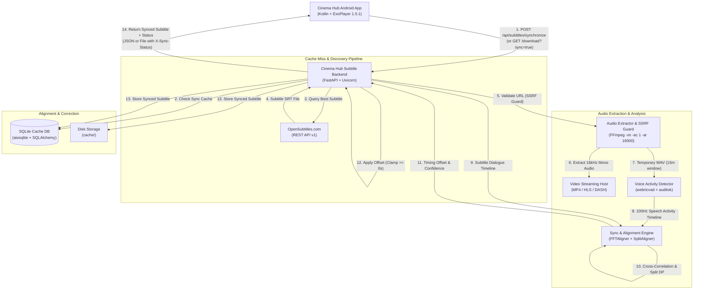

# Cinema Hub — Automated Subtitle & Audio Synchronization Backend

A production-ready, asynchronous subtitle and audio synchronization service engineered specifically for the **Cinema Hub** Android application (Kotlin, Jetpack Compose, Media3 ExoPlayer 1.5.1).

The backend acts as a secure, high-performance intermediary between Cinema Hub and the official **OpenSubtitles REST API v1**, and provides **server-side automatic subtitle audio synchronization**. It analyzes the actual audio of the video stream, calculates speech-to-subtitle timing offsets (handling intros, recaps, and commercial cuts), normalizes text (with native support for Arabic and RTL scripts), and returns synchronized subtitle files directly to the Android client.

---

## 1. Architecture Overview



---

## 2. Key Features

### Automatic Audio Synchronization (Server-Side)
- **Zero Client Overhead**: All expensive audio decoding, VAD, and cross-correlation happen entirely on the backend server. The Android device simply downloads the synchronized file.
- **VAD Speech Detection**: Uses `webrtcvad` (Gaussian Mixture Models) backed by `auditok` energy-based analysis to build a 100 Hz speech timeline from the video's actual audio track.
- **FFT Cross-Correlation**: Evaluates cross-correlation across forward and backward search windows to discover the exact millisecond audio-to-dialogue offset.
- **Intro, Recap & Ad Handling**: Employs piecewise dynamic programming (`compute_split_offsets`) to detect and correct opening intros, credits, recaps, and commercial cuts where the subtitle timeline differs from the video start.
- **Quality & Fallback Classification**:
  - `synchronized`: Audio-based synchronization succeeded with strong confidence ($\ge 0.30$ speech overlap).
  - `already_aligned`: Analysis confirms subtitle is already in sync with audio ($|\Delta t| < 0.25$s).
  - `partial`: Subtitle shifted based on moderate confidence ($0.10 \le \text{confidence} < 0.30$).
  - `unavailable`: Video audio could not be accessed; original subtitle returned intact.
  - `unsupported`: Stream uses DRM or unsupported container; original subtitle preserved.
  - `failed`: Audio contained no detectable speech; original subtitle preserved without applying random shifts.

### OpenSubtitles REST API v1 Integration
- **Session Management**: Authenticates via `/api/v1/login`, manages Bearer Tokens in memory, and handles automatic renewals.
- **Connection Pooling & Concurrency**: Bounded HTTPX connection pools with exponential backoff on HTTP 429 and 503 errors.
- **Thundering Herd Protection**: Single `asyncio.Lock` per cache key prevents duplicate logins and redundant downloads.

### Subtitle Processing & Normalization
- **Supported Formats**: `SRT`, `WebVTT`, `ASS`, `SSA`, `TTML`, `DFXP`, and validated subtitle `XML`.
- **Encoding Normalization**: Auto-detects and converts legacy `Windows-1256` (Arabic), `CP1252`, `ISO-8859-1`, and `UTF-16` into clean UTF-8 without BOM.
- **Arabic Character Preservation**: Preserves Arabic Unicode blocks, right-to-left marks, and punctuation without corruption.
- **ExoPlayer Conversion**: Automatic, non-destructive SRT-to-WebVTT conversion.

### Security & Resource Protection
- **SSRF Protection**: Blocks external stream URLs targeting localhost, private RFC 1918 networks, link-local addresses, and cloud metadata endpoints (`169.254.169.254`).
- **Header Sanitization**: Filters client playback headers, stripping CRLF and control characters to prevent request smuggling.
- **Resource Bounds**: Bounded concurrent sync jobs (`MAX_CONCURRENT_SYNC_JOBS=2`), bounded audio extraction window (default 15 minutes / 50 MB), and 45-second execution timeout.
- **Temporary Cleanup**: All audio scratch files (`.wav`) are deleted in `try...finally` blocks.

---

## 3. Technology Stack & Prerequisites

- **Python**: 3.11 or newer (fully tested on 3.11, 3.12, 3.13, and 3.14)
- **FastAPI & Uvicorn**: High-performance asynchronous web framework
- **FFmpeg**: Bundled portably via `imageio-ffmpeg` (or system FFmpeg)
- **FFsubsync, webrtcvad-wheels, auditok**: Speech extraction and alignment
- **NumPy, srt, pysubs2**: Vectorized matrix math and subtitle cue manipulation
- **SQLAlchemy & aiosqlite**: Asynchronous persistent metadata and cache storage
- **Pydantic & Pydantic-Settings**: Configuration and validation
- **Pytest & Pytest-Asyncio**: 70 automated tests

---

## 4. Local Installation & Setup (Windows & PowerShell)

```powershell
# 1. Navigate to workspace
cd c:\Users\JHN\Desktop\SubtitleServer

# 2. Activate virtual environment
.\.venv\Scripts\Activate.ps1

# 3. Install dependencies
pip install -r requirements.txt

# 4. Configure environment
Copy-Item .env.example .env
# Fill in OPENSUBTITLES_API_KEY, OPENSUBTITLES_USERNAME, OPENSUBTITLES_PASSWORD

# 5. Run ASGI server
uvicorn app.main:app --reload --host 0.0.0.0 --port 8000
```

---

## 5. API Reference

### A. Health Check
`GET /api/subtitles/health`

**Response (200 OK)**:
```json
{
  "status": "healthy",
  "service": "cinema-hub-subtitles",
  "version": "1.1.0"
}
```

---

### B. Discover Available Languages
`GET /api/subtitles/languages`

**Query Parameters**:
| Parameter | Type | Required | Description |
| :--- | :--- | :--- | :--- |
| `imdb_id` | String | Conditional* | IMDb ID (e.g. `tt0111161` or `0111161`) |
| `query` | String | Conditional* | Title of movie or TV show |
| `year` | Integer | Optional | Release year (e.g. `1994`) |
| `type` | String | Optional | `movie`, `episode`, or `all` |
| `season_number` | Integer | Optional | Season number for TV shows |
| `episode_number`| Integer | Optional | Episode number for TV shows |

*\* At least one of `imdb_id` or `query` is required.*

---

### C. Synchronize Subtitle with Audio
`POST /api/subtitles/synchronize`

**Purpose**: Extracts audio from `stream_url`, performs speech alignment against the subtitle, and returns a synchronized subtitle along with detailed quality metrics.

**Request Body (JSON)**:
```json
{
  "imdb_id": "tt0111161",
  "query": "The Shawshank Redemption",
  "language": "ar",
  "format": "vtt",
  "stream_url": "https://cdn.example.com/movies/shawshank/index.m3u8",
  "stream_headers": {
    "User-Agent": "CinemaHubApp/1.5.1",
    "Referer": "https://cinema-hub.org/watch"
  }
}
```

**Response (200 OK)**:
```json
{
  "success": true,
  "sync_status": "synchronized",
  "language": "ar",
  "format": "vtt",
  "audio_analyzed": true,
  "offset_seconds": 12.450,
  "confidence_score": 0.820,
  "processing_time_seconds": 4.120,
  "cues_count": 1120,
  "subtitle_content": "WEBVTT\n\n1\n00:00:13.450 --> 00:00:16.950\nمرحبا بكم في سينما هاب!\n...",
  "detail": "Alignment status: synchronized"
}
```

---

### D. Download Subtitle (with Optional Auto-Sync)
`GET /api/subtitles/download`

**Query Parameters**:
| Parameter | Type | Required | Description |
| :--- | :--- | :--- | :--- |
| `language` | String | **Required** | ISO language code (e.g. `ar`, `en`) |
| `imdb_id` | String | Conditional | IMDb ID |
| `query` | String | Conditional | Title |
| `format` | String | Optional | `srt` or `vtt` (default: `srt`) |
| `sync` | Boolean | Optional | Set `true` to auto-synchronize to stream audio |
| `stream_url` | String | Optional | Video playback URL (MP4, HLS, DASH) |

**Example Request**:
```http
GET /api/subtitles/download?imdb_id=tt0111161&language=ar&format=vtt&sync=true&stream_url=https://cdn.example.com/video.mp4 HTTP/1.1
Host: localhost:8000
```

**Response Headers**:
```http
HTTP/1.1 200 OK
Content-Type: text/vtt; charset=utf-8
Content-Disposition: attachment; filename="The.Shawshank.Redemption.ar.vtt"
X-Cache: MISS
X-Sync-Status: synchronized
X-Sync-Offset: 12.450
X-Audio-Analyzed: true
```

---

## 6. Android Integration Guide (Cinema Hub)

### Retrofit API Interface
```kotlin
interface SubtitleApiService {
    @POST("api/subtitles/synchronize")
    suspend fun synchronizeSubtitle(
        @Body request: SyncRequest
    ): Response<SyncResponse>
}

data class SyncRequest(
    val language: String,
    val imdb_id: String? = null,
    val query: String? = null,
    val format: String = "vtt",
    val stream_url: String? = null,
    val stream_headers: Map<String, String>? = null
)

data class SyncResponse(
    val success: Boolean,
    val sync_status: String,
    val language: String,
    val format: String,
    val audio_analyzed: Boolean,
    val offset_seconds: Double?,
    val confidence_score: Double?,
    val subtitle_content: String?,
    val detail: String?
)
```

### Media3 ExoPlayer Attachment
```kotlin
fun attachSubtitleToPlayer(
    context: Context,
    exoPlayer: ExoPlayer,
    subtitleText: String,
    format: String,
    language: String
) {
    // 1. Write synchronized subtitle to temporary cache file
    val extension = if (format == "vtt") "vtt" else "srt"
    val subFile = File(context.cacheDir, "current_subtitle.$extension")
    subFile.writeText(subtitleText, Charsets.UTF_8)

    val mimeType = if (format == "vtt") MimeTypes.TEXT_VTT else MimeTypes.APPLICATION_SUBRIP
    val subtitleUri = Uri.fromFile(subFile)

    // 2. Configure subtitle without interrupting playback
    val currentPosition = exoPlayer.currentPosition
    val currentMediaItem = exoPlayer.currentMediaItem ?: return

    val subtitleConfig = MediaItem.SubtitleConfiguration.Builder(subtitleUri)
        .setMimeType(mimeType)
        .setLanguage(language)
        .setSelectionFlags(C.SELECTION_FLAG_DEFAULT)
        .build()

    val updatedMediaItem = currentMediaItem.buildUpon()
        .setSubtitleConfigurations(listOf(subtitleConfig))
        .build()

    // 3. Update player item while preserving seek position and state
    exoPlayer.setMediaItem(updatedMediaItem, currentPosition)
    exoPlayer.prepare()
}
```

### Jetpack Compose UI Indicator
```kotlin
@Composable
fun SubtitleSyncStatusBanner(syncStatus: String, offsetSeconds: Double?) {
    when (syncStatus) {
        "syncing" -> {
            Row(modifier = Modifier.padding(8.dp), verticalAlignment = Alignment.CenterVertically) {
                CircularProgressIndicator(modifier = Modifier.size(16.dp), strokeWidth = 2.dp)
                Spacer(modifier = Modifier.width(8.dp))
                Text("Synchronizing subtitles with audio...", color = Color.White)
            }
        }
        "synchronized" -> {
            val offsetText = offsetSeconds?.let { String.format("%+.2fs", it) } ?: ""
            Text("Subtitle synchronized successfully ($offsetText)", color = Color.Green)
        }
        "already_aligned" -> {
            Text("Subtitle is already synchronized", color = Color.Green)
        }
        "unavailable", "unsupported" -> {
            Text("Original subtitle loaded – synchronization unavailable", color = Color.Yellow)
        }
        "failed" -> {
            Text("Subtitle synchronization failed – original subtitle active", color = Color.Yellow)
        }
    }
}
```

---

## 7. Automated Testing Suite

The repository includes **70 automated tests** covering every functional component:

```powershell
.\.venv\Scripts\Activate.ps1
pytest
```

```text
================== 69 passed, 1 skipped in 1.95s ===================
```

### Test Coverage Highlights:
- **`tests/test_ssrf_and_headers.py`**: Validates blocking of `localhost`, `127.0.0.1`, RFC 1918 private subnets, cloud metadata `169.254.169.254`, and non-HTTP schemes; verifies header sanitization and CRLF injection defense.
- **`tests/test_audio_extractor.py`**: Tests container detection (HLS `.m3u8`, DASH `.mpd`, Direct MP4/MP3), header arguments assembly, SSRF rejection, and extraction timeout handling.
- **`tests/test_sync_service.py`**: Tests cue parsing, timestamp shifting, negative timestamp clamping at 0.0s, synthetic audio alignment (`already_aligned`, delayed subtitle -10s correction, video intro +15s correction, Arabic text preservation, silent audio fallback, and missing audio stream fallback).
- **`tests/test_sync_api.py`**: Full API integration testing for `POST /api/subtitles/synchronize` and `GET /api/subtitles/download?sync=true`.
- **`tests/test_cache.py`, `tests/test_health.py`, `tests/test_opensubtitles.py`, `tests/test_subtitle_validation.py`**: All legacy tests pass with 100% backward compatibility.

---

## 8. Render.com Deployment Configuration

The [`render.yaml`](file:///c:/Users/JHN/Desktop/SubtitleServer/render.yaml) file is configured for Render.com Web Services:

```yaml
services:
  - type: web
    name: cinema-hub-subtitle-backend
    runtime: python
    buildCommand: "pip install -r requirements.txt"
    startCommand: "uvicorn app.main:app --host 0.0.0.0 --port $PORT"
    healthCheckPath: /api/subtitles/health
    plan: free
    autoDeploy: true

    envVars:
      - key: PYTHON_VERSION
        value: 3.11.9
      - key: APP_NAME
        value: CinemaHubSubtitleBackend
      - key: APP_VERSION
        value: 1.1.0
      - key: MAX_CONCURRENT_SYNC_JOBS
        value: 2
      - key: MAX_AUDIO_EXTRACT_SECONDS
        value: 900
      - key: MAX_AUDIO_EXTRACT_SIZE_MB
        value: 50
      - key: FFMPEG_TIMEOUT_SECONDS
        value: 45
```

---

## 9. Limitations & Practical Notes

1. **DRM Protection**: Video streams protected with Widevine or FairPlay DRM encrypt audio tracks. The server cannot decrypt DRM streams and safely returns `sync_status: "unsupported"`, delivering the original subtitle.
2. **Audio Extraction Windows**: To respect Render compute quotas and memory limits, audio extraction is bounded to the first 15 minutes of media (configurable via `MAX_AUDIO_EXTRACT_SECONDS`). This is sufficient to detect constant offsets, intro delays, and initial recap lengths.
3. **Manual Offset Controls**: Server-side synchronization corrects the primary audio alignment. Users can still fine-tune offsets in Cinema Hub if a non-standard video rip exhibits framerate variance.
