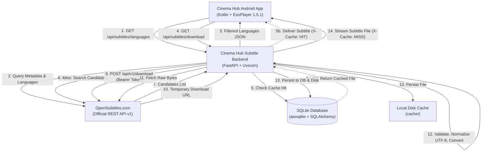

# Cinema Hub — Automated Subtitle Backend

A production-ready, asynchronous subtitle service engineered specifically for the **Cinema Hub** Android application (Kotlin, Jetpack Compose, Media3 ExoPlayer 1.5.1).

The backend acts as a secure, high-performance intermediary between Cinema Hub and the official **OpenSubtitles REST API v1**. It handles authentication, subtitle discovery, candidate ranking, multi-lingual normalization (with native support for Arabic and RTL scripts), format conversion (SRT to WebVTT), in-flight request deduplication, and persistent SQLite + disk caching.

---

## 1. Architecture Overview

The Cinema Hub Android client never communicates directly with OpenSubtitles, keeping OpenSubtitles credentials and internal tokens secure.



---

## 2. Key Features

- **Official OpenSubtitles REST API v1 Integration**:
  - Secure `/api/v1/login` session management with automatic memory caching and expiration handling.
  - Asynchronous HTTP client using `httpx` with connection pooling.
  - Concurrency rate limiter (`asyncio.Semaphore`) and bounded exponential backoff on HTTP 429 and 503 errors.
  - Thundering herd prevention on authentication via `asyncio.Lock`.
- **Deterministic Candidate Ranking**:
  - Scores subtitles based on uploader trust (`from_trusted`), community rating (`ratings`), vote count, download volume (logarithmic scale), and HD release timing.
  - Heavily penalizes AI or machine translated subtitles.
  - Documented, predictable tie-breaker policy.
- **Subtitle Processing & Validation**:
  - Supported input formats: `SRT`, `WebVTT`, `ASS`, `SSA`, `TTML`, `DFXP`, and validated subtitle `XML`.
  - Encoding auto-detection with priority handling for Arabic (`Windows-1256`, `CP1256`) and Western encodings (`CP1252`, `ISO-8859-1`, `UTF-16`).
  - Normalizes text to pure UTF-8 without BOM.
  - Rejects empty files, binary garbage, HTML error pages, Cloudflare challenge pages, and CAPTCHAs.
  - Converts SRT to WebVTT seamlessly while preserving tags, line breaks, timestamps, and Arabic RTL marks.
  - Refuses destructive ASS/SSA conversion to preserve complex stylings.
- **Persistent Two-Tier Caching**:
  - Metadata indexed in SQLite via `SQLAlchemy 2.0` and `aiosqlite`.
  - Normalized files stored locally with path-traversal protection.
  - Configurable TTL (default: 7 days / 168 hours).
  - In-flight request deduplication prevents redundant downloads for simultaneous identical client requests.
  - Automatic expired cache cleanup on application boot.
- **Security & Reliability**:
  - Zero credential leaks in public responses or log files.
  - Strict input validation via Pydantic.
  - Configurable CORS support.
  - Ready for Render.com deployment with persistent disk support.

---

## 3. Technology Stack & Prerequisites

- **Python**: 3.11 or newer (tested on Python 3.11, 3.12, 3.13, and 3.14)
- **FastAPI**: Modern, asynchronous web framework
- **Uvicorn**: High-performance ASGI server
- **HTTPX**: Asynchronous HTTP client with connection pooling
- **SQLAlchemy & aiosqlite**: Asynchronous ORM and SQLite driver
- **Pydantic & Pydantic-Settings**: Request validation and type-safe configuration
- **Charset-Normalizer**: Character encoding detection
- **Pytest & Pytest-Asyncio**: Comprehensive automated test suite

---

## 4. Local Installation & Setup (Windows & PowerShell)

Follow these steps inside Windows PowerShell:

### Step 1: Clone or Navigate to the Workspace
```powershell
cd c:\Users\JHN\Desktop\SubtitleServer
```

### Step 2: Create a Virtual Environment
```powershell
python -m venv .venv
```

### Step 3: Activate the Virtual Environment
```powershell
.\.venv\Scripts\Activate.ps1
```
*(If PowerShell restricts script execution, run: `Set-ExecutionPolicy -Scope Process -ExecutionPolicy Bypass`)*

### Step 4: Install Dependencies
```powershell
python -m pip install --upgrade pip
pip install -r requirements.txt
```

### Step 5: Configure Environment Variables
Copy `.env.example` to `.env`:
```powershell
Copy-Item .env.example .env
```
Open `.env` and fill in your OpenSubtitles credentials:
```ini
OPENSUBTITLES_API_KEY=your_developer_api_key
OPENSUBTITLES_USERNAME=your_username
OPENSUBTITLES_PASSWORD=your_password
```

### Step 6: Start the Development Server
```powershell
uvicorn app.main:app --reload --host 0.0.0.0 --port 8000
```
Open your browser at:
- **Interactive API Documentation (Swagger)**: http://localhost:8000/docs
- **Alternative Documentation (ReDoc)**: http://localhost:8000/redoc
- **Health Check**: http://localhost:8000/api/subtitles/health

---

## 5. API Reference

### A. Health Check
`GET /api/subtitles/health`

**Purpose**: Verifies that the service is running and operational.

**Response (200 OK)**:
```json
{
  "status": "healthy",
  "service": "cinema-hub-subtitles",
  "version": "1.0.0"
}
```

---

### B. Discover Available Languages
`GET /api/subtitles/languages`

**Purpose**: Searches OpenSubtitles for subtitles matching a movie or TV show, and groups them by available language codes.

**Query Parameters**:
| Parameter | Type | Required | Description |
| :--- | :--- | :--- | :--- |
| `imdb_id` | String | Conditional* | IMDb ID (e.g. `tt0111161` or `0111161`) |
| `query` | String | Conditional* | Title of movie or TV show |
| `year` | Integer | Optional | Release year (e.g. `1994`) |
| `type` | String | Optional | `movie`, `episode`, or `all` (default: `movie`) |
| `season_number` | Integer | Optional | Season number for TV shows |
| `episode_number`| Integer | Optional | Episode number for TV shows |

*\* At least one of `imdb_id` or `query` is required.*

**Example Request**:
```http
GET /api/subtitles/languages?imdb_id=tt0111161 HTTP/1.1
Host: localhost:8000
```

**Example Response (200 OK)**:
```json
{
  "success": true,
  "movie": {
    "imdb_id": "tt0111161",
    "title": "The Shawshank Redemption"
  },
  "languages": [
    {
      "language_code": "ar",
      "language_name": "Arabic",
      "available_files": 12
    },
    {
      "language_code": "en",
      "language_name": "English",
      "available_files": 25
    },
    {
      "language_code": "es",
      "language_name": "Spanish",
      "available_files": 18
    }
  ]
}
```

---

### C. Download Selected Subtitle
`GET /api/subtitles/download`

**Purpose**: Selects the best suitable candidate using the deterministic ranking algorithm, downloads it, validates and normalizes it to UTF-8, caches it locally, and streams the file to the client.

**Query Parameters**:
| Parameter | Type | Required | Description |
| :--- | :--- | :--- | :--- |
| `language` | String | **Required** | ISO 639-1 / 639-2 language code (e.g. `ar`, `en`) |
| `imdb_id` | String | Conditional* | IMDb ID (e.g. `tt0111161`) |
| `query` | String | Conditional* | Title (e.g. `The Shawshank Redemption`) |
| `year` | Integer | Optional | Release year |
| `type` | String | Optional | `movie` or `episode` |
| `season_number` | Integer | Optional | TV season number |
| `episode_number`| Integer | Optional | TV episode number |
| `format` | String | Optional | `srt` or `vtt` (default: `srt`) |
| `hearing_impaired` | Boolean | Optional | Set to `true` to prefer SDH / hearing-impaired |

**Example Request (ExoPlayer WebVTT request)**:
```http
GET /api/subtitles/download?imdb_id=tt0111161&language=ar&format=vtt HTTP/1.1
Host: localhost:8000
```

**Response Headers (200 OK)**:
```http
HTTP/1.1 200 OK
Content-Type: text/vtt; charset=utf-8
Content-Disposition: attachment; filename="The.Shawshank.Redemption.ar.vtt"; filename*=UTF-8''The.Shawshank.Redemption.ar.vtt
X-Cache: MISS
X-Subtitle-Format: vtt
X-Subtitle-Cue-Count: 1120
Cache-Control: public, max-age=86400
```

Subsequent identical requests return `X-Cache: HIT` instantly without contacting OpenSubtitles.

---

## 6. Deterministic Ranking Algorithm

When multiple subtitle candidates match the requested title and language, the backend selects the candidate with the highest deterministic score:

$$Score = \text{Trust} + \text{Rating} + \text{Votes} + \text{Downloads} + \text{HD} + \text{Match} - \text{Penalties}$$

### Point Breakdown
1. **Trusted Source (`from_trusted`)**: `+100.0` points. Verified uploaders produce consistent, properly synced subtitles.
2. **Community Rating (`ratings`)**: `ratings * 10.0` points (up to `+100.0` points for a 10.0 rating).
3. **Rating Confidence (`votes`)**: $\min(\text{votes} \times 2.0, 50.0)$ points.
4. **Download Volume (`download_count`)**: Logarithmic scaling: $\min(\log_{10}(\text{downloads} + 1) \times 15.0, 75.0)$ points.
5. **High Definition (`hd`)**: `+15.0` points (better alignment with modern 720p/1080p/4K rips).
6. **Release Name Match**: Up to `+30.0` points when candidate release tag matches query release keywords.
7. **Hearing Impaired Alignment**:
   - If not requested: `-10.0` points (favors standard subtitles for general streaming).
   - If requested: `+20.0` points.
8. **Penalties**:
   - **Machine Translated**: `-150.0` points.
   - **AI Translated**: `-150.0` points.
   - **Foreign Parts Only**: `-50.0` points.
9. **Tie-Breaker**:
   - `(-ranking_score, -download_count, -ratings, file_id)` ensures deterministic selection.

> [!NOTE]
> High ratings or download volumes reflect community consensus, but do not mathematically guarantee video synchronization with every custom rip.

---

## 7. Subtitle Validation & Security

The `SubtitleManager` performs strict validation to prevent malicious or broken content from reaching the client:
- **Encoding Normalization**: Converts legacy Windows-1256 (Arabic), CP1252, and UTF-16 into clean UTF-8. UTF-8 BOM is stripped.
- **Arabic & RTL Preservation**: Preserves Arabic Unicode blocks, punctuation, and timestamps without mangling.
- **Rejection Triggers**:
  - Empty files (`0` bytes).
  - Cloudflare anti-bot challenge pages and CAPTCHAs.
  - HTML error pages (e.g. `502 Bad Gateway`).
  - Binary executables containing null bytes (`\x00`).
  - Files lacking timestamp cues.
  - Files exceeding `MAX_SUBTITLE_FILE_SIZE_MB` (default 10 MB) or `MAX_SUBTITLE_CUE_COUNT` (default 50,000 cues).
- **Path Traversal Protection**: All stored and retrieved file paths are resolved and strictly asserted to reside inside the configured cache directory.

---

## 8. Automated Testing

The project includes 44 unit and integration tests covering all critical paths:

```powershell
.\.venv\Scripts\Activate.ps1
pytest
```

### Test Coverage Highlights:
- **`tests/test_health.py`**: Health endpoint and metadata validation.
- **`tests/test_subtitle_validation.py`**: Format detection (SRT, VTT, ASS, TTML), BOM stripping, Arabic Windows-1256 decoding, Cloudflare/HTML rejection, null byte rejection, and file size limits.
- **`tests/test_subtitle_conversion.py`**: SRT-to-WebVTT conversion, timestamp transformation (`00:00:01,000` $\to$ `00:00:01.000`), Arabic RTL preservation, and ASS style preservation refusal.
- **`tests/test_cache.py`**: Cache key generation, store & hit, TTL expiration, disk file cleanup, and in-flight request deduplication lock.
- **`tests/test_opensubtitles.py`**: Authentication lifecycle, token caching, thundering herd prevention, candidate ranking, exponential backoff, and 401 token refresh.
- **`tests/test_subtitles_api.py`**: End-to-end API integration tests for `/api/subtitles/languages` and `/api/subtitles/download` with cache miss & hit verification.

### Running Live Integration Test (Optional)
To test against the live OpenSubtitles production API with real credentials:
```powershell
$env:LIVE_OPENSUBTITLES_TEST="1"
pytest -k test_live_opensubtitles_integration
```

---

## 9. Render.com Deployment Guide

The repository includes a ready-to-deploy `render.yaml` blueprint.

### Deployment Steps:
1. Push the code to a GitHub repository:
   ```bash
   git init
   git add .
   git commit -m "Initial commit of Cinema Hub Subtitle Backend"
   git remote add origin https://github.com/your-username/cinema-hub-subtitle-backend.git
   git push -u origin main
   ```
2. Log in to [Render.com](https://render.com).
3. Click **New +** $\to$ **Blueprint**.
4. Connect your GitHub repository. Render will automatically read `render.yaml`.
5. In the Render Dashboard under **Environment Variables**, supply your OpenSubtitles credentials:
   - `OPENSUBTITLES_API_KEY`
   - `OPENSUBTITLES_USERNAME`
   - `OPENSUBTITLES_PASSWORD`
6. Click **Apply**. Render will build and deploy the service.

### Persistent Disk Note:
- `render.yaml` configures a 1 GB persistent disk mounted at `/var/data` for SQLite (`/var/data/subtitles.db`) and cached files (`/var/data/cache`).
- Persistent disks are supported on Render Starter or higher plans.
- On free-tier plans where persistent disks are not attached, the backend automatically functions using ephemeral storage (`./subtitles.db` and `./cache`), re-fetching subtitles when the instance spins down.

---

## 10. ExoPlayer Android Integration (Client Side)

In your Cinema Hub Android application (Kotlin + Media3 ExoPlayer 1.5.1):

```kotlin
val subtitleUri = Uri.parse("https://your-backend.onrender.com/api/subtitles/download?imdb_id=tt0111161&language=ar&format=vtt")

val subtitleConfig = MediaItem.SubtitleConfiguration.Builder(subtitleUri)
    .setMimeType(MimeTypes.TEXT_VTT)
    .setLanguage("ar")
    .setSelectionFlags(C.SELECTION_FLAG_DEFAULT)
    .build()

val mediaItem = MediaItem.Builder()
    .setUri(videoStreamUri)
    .setSubtitleConfigurations(listOf(subtitleConfig))
    .build()

exoPlayer.setMediaItem(mediaItem)
exoPlayer.prepare()
exoPlayer.play()
```

---

## 11. Known Limitations & Recommendations

1. **OpenSubtitles Download Quotas**: Free OpenSubtitles user accounts have a daily download quota (typically 5 to 20 subtitles per day). The persistent cache significantly conserves this quota. Upgrading to an OpenSubtitles VIP or Commercial account increases quotas to 1,000+ daily downloads.
2. **Video Rip Synchronization**: Subtitles are selected based on community ratings and matching release names. If a user plays an unusual or re-encoded video rip with non-standard framerate shifts, subtitles may require timeshift adjustment in the player.
3. **ASS/SSA Styling**: ASS subtitles with complex karaoke or typesetting animations are served in their native format to prevent silent style destruction. ExoPlayer handles SRT and WebVTT natively.

---

## 12. License

Proprietary — Internal service for Cinema Hub.

